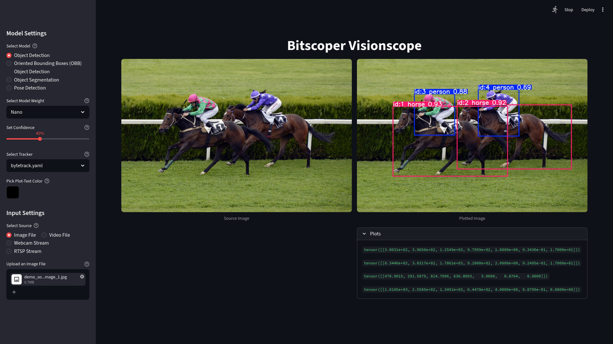
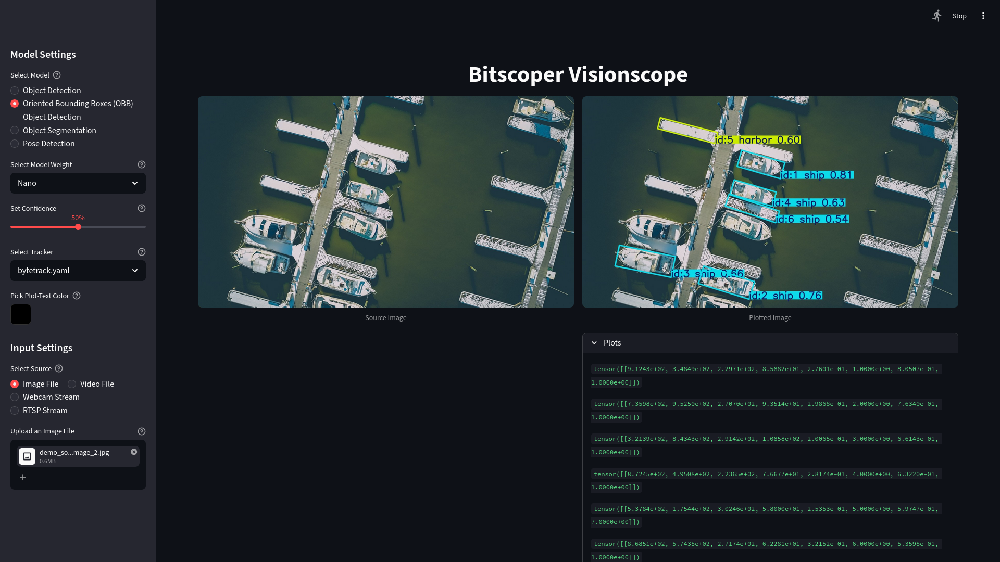
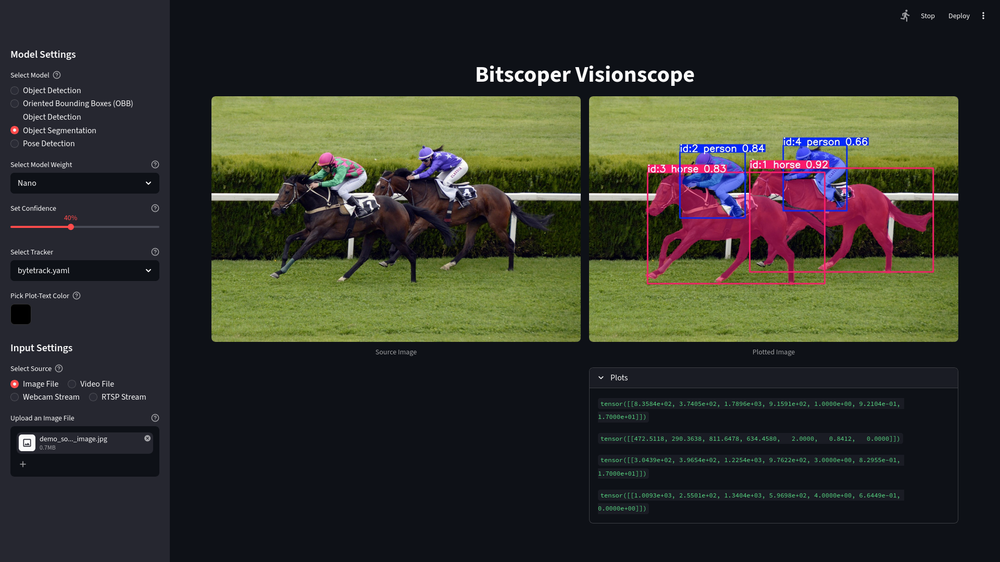
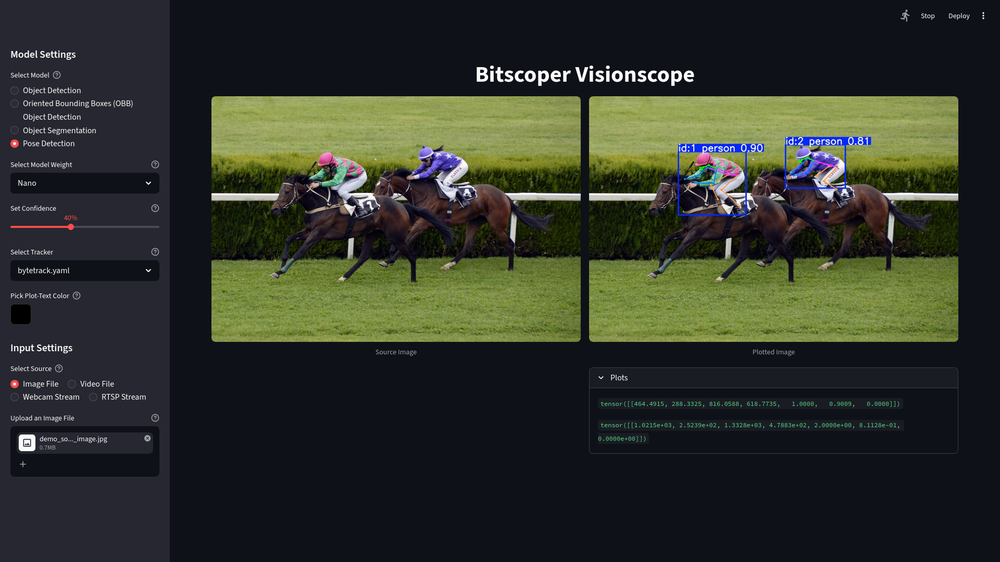

<div align="center">

# Bitscoper Visionscope

Object Detection, Oriented Bounding Boxes (OBB) Object Detection, Object Segmentation, and Pose Detection from Image Files, Video Files, Webcams, and RTSP Streams Using Ultralytics YOLO26 in Streamlit

[](#notes)

</div>

## Screenshots

### Object Detection



---

### Oriented Bounding Boxes (OBB) Object Detection



---

### Object Segmentation



---

### Pose Detection



## Usage

```sh
python3.12 -m venv ./.venv

source ./.venv/bin/activate

pip3.12 install -r requirements.txt

python3.12 -m streamlit run main.py
```

If you encounter the error `Original error was: libstdc++.so.6: cannot open shared object file: No such file or directory` on NixOS, try running:

```sh
nix-shell -p steam-run-free --run "steam-run python3.12 -m streamlit run main.py"
```

## Notes

- I only use AI to search for alternatives and possibilities during brainstorming. AI-generated code from contributors is also not allowed.
- I commit multiple changes in a single commit.
- I write commit messages in Title Case and past tense, leaving out articles to keep them concise while still showing details.
- I previously reuploaded the repository to clean up the commit history and later deleted some commits.
- I later [PGP](https://github.com/bitscoper/bitscoper#pgp-public-key)-signed all my commits, so they show later dates.
